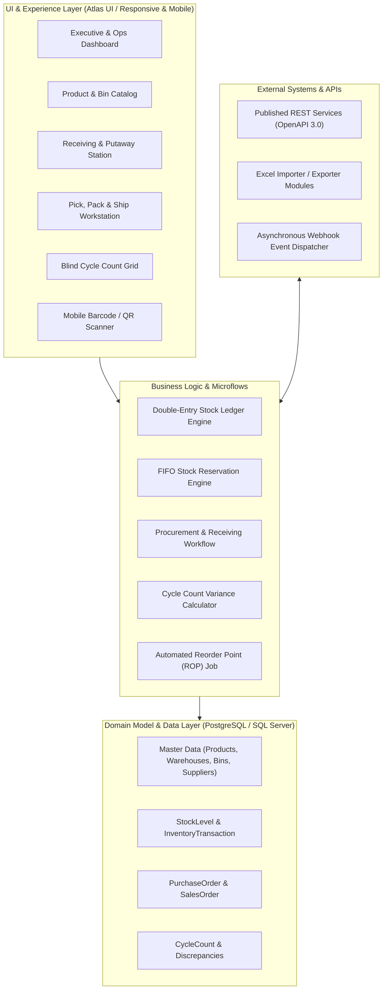

# Inventory Management System (IMS) — Mendix Implementation Guide

Welcome to the comprehensive implementation guide for building an enterprise-grade **Inventory Management System (IMS)** using **Mendix Studio Pro** (compatible with Mendix 10.x LTS).

This documentation provides end-to-end specifications, domain models, microflow architectures, UI/UX designs, security matrices, and integration blueprints aligned with our Scrumit project board.

---

## 1. System Architecture Overview

The system is designed as a modular low-code enterprise application adhering to clean separation of concerns:

---

## 2. Modular Structure in Mendix Studio Pro

To ensure high maintainability and prevent circular dependencies, organize the project into focused Mendix modules:

| Module Name | Purpose & Scope | Key Dependencies |
| :--- | :--- | :--- |
| **`MasterData`** | Products, Categories, Units of Measure (UoM), Warehouses, Zones, Bins, Suppliers | None (Core Base) |
| **`Inventory`** | Stock levels, location quantities, immutable transaction ledger, adjustments, inter-warehouse transfers | `MasterData` |
| **`Procurement`** | Purchase orders, vendor lead times, goods receiving, putaway routing, quality inspection/quarantine | `MasterData`, `Inventory` |
| **`Fulfillment`** | Sales order reservations, picking waves, packing verification, shipping dispatch, packing slip generation | `MasterData`, `Inventory` |
| **`InventoryAudit`**| Cycle count planning, blind physical count entry, variance reconciliation, ABC analysis | `MasterData`, `Inventory` |
| **`Notifications`** | Reorder threshold monitoring, scheduled jobs, in-app alert center, email dispatches | `Inventory`, `Procurement` |
| **`IMS_Integration`**| Published REST endpoints, webhook dispatcher, Excel batch import/export templates | All operational modules |
| **`IMS_UI`** | Layouts, dashboard widgets, responsive navigation profiles, barcode scanner components | All modules |

---

## 3. Documentation Index

Detailed implementation chapters:

1. [**Domain Model & Entities**](domain-model.md) — Comprehensive entity definitions, attribute types, associations, unique constraints, and database indexes.
2. [**Security & User Access Control**](security-and-roles.md) — Role-based access control (RBAC), module roles, entity access rules, and XPath constraints.
3. [**Business Logic & Microflows**](business-logic-microflows.md) — Detailed microflow & nanoflow specifications, transactional safety, stock calculation algorithms, and scheduled events.
4. [**UI & UX Design**](ui-and-ux-design.md) — Atlas UI layout templates, Data Grid 2 configuration, mobile scanner integration, and responsive patterns.
5. [**Integrations & REST APIs**](integrations-and-apis.md) — Published REST service specifications, Swagger definitions, Excel batch migrations, and webhooks.
6. [**Deployment & Best Practices**](deployment-and-best-practices.md) — Performance optimizations, caching, UnitTesting framework, and CI/CD pipelines.

---

## 4. Scrumit Project Roadmap Alignment

The development lifecycle is tracked in our Git repository using `scrumit`:

- **Sprint 01 (`2026-S01`)**: Foundation & Master Data (Products, Warehouses, Suppliers, RBAC, Excel Import, Testing)
- **Sprint 02 (`2026-S02`)**: Stock Operations & Inbound Receiving (Transaction Ledger, Stock Transfers, Adjustments, Purchase Orders, Goods Receipt)
- **Sprint 03 (`2026-S03`)**: Fulfillment, Auditing & Integrations (Order Reservation, Pick/Pack/Ship, Cycle Counts, Reorder Alerts, Mobile Scanner, REST API)
- **Backlog**: Lot/Batch Expiration, Serialized Tracking, ABC Velocity Stratification, Executive Valuation Analytics, Webhooks
