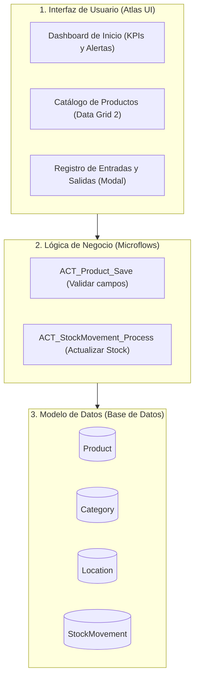

# Sistema de Gestión de Inventarios (IMS) — Guía Práctica en Mendix

Bienvenido a la documentación práctica para construir una aplicación de **Gestión de Inventarios (Demo)** utilizando **Mendix Studio Pro**.

Este proyecto está diseñado especialmente como una **práctica guiada de aprendizaje** para comprender los pilares fundamentales de Mendix:
1. **Modelado de Dominio (Domain Model):** Entidades, atributos, enumeraciones y asociaciones.
2. **Lógica Visual (Microflows):** Validaciones, condicionales y actualización de stock.
3. **Interfaz de Usuario (Atlas UI):** Data Grid 2, modales emergentes y tarjetas de KPIs.
4. **Seguridad Básica (Project Security):** Roles de usuario y permisos de acceso.

---

## 1. Arquitectura de la Solución Demo

La aplicación se compone de un solo módulo principal (`InventoryManagement`) para mantener la simplicidad:

---

## 2. Índice de Documentación

Explora cada sección para construir la aplicación paso a paso:

1. [**Guía Tutorial Paso a Paso**](guia-paso-a-paso-mendix.md) — Instrucciones detalladas desde la creación del proyecto hasta ejecutar la app localmente.
2. [**Modelo de Datos Simplificado**](modelo-de-datos.md) — Las 4 entidades clave, atributos, tipos de datos y relaciones.
3. [**Lógica y Microflows**](logica-y-microflows.md) — Flujos visuales para validación de datos y actualización de existencias (+ entradas / - salidas).
4. [**Diseño de Páginas y UI**](interfaz-y-paginas.md) — Configuración del Dashboard con KPIs y catálogo con Data Grid 2.
5. [**Seguridad y Roles**](seguridad-y-roles.md) — Configuración de perfiles `Administrator` y `WarehouseOperator`.

---

## 3. Plan de Sprints de la Práctica (Scrumit)

- **[Sprint 01 (`2026-S01`)](file:///Users/neurd/dev/ims/sprints/2026-S01/sprint.md)**: Modelo de Datos, Catálogo de Productos y Seguridad (`IMS-1` al `IMS-4`).
- **[Sprint 02 (`2026-S02`)](file:///Users/neurd/dev/ims/sprints/2026-S02/sprint.md)**: Movimientos de Stock (+/-), Alertas de Stock Bajo y Dashboard (`IMS-5` al `IMS-8`).
- **[Backlog Opcional](file:///Users/neurd/dev/ims/backlog/)**: Importación Excel y lector de código de barras (`IMS-9` e `IMS-10`).
