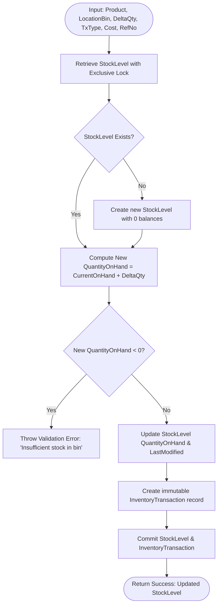
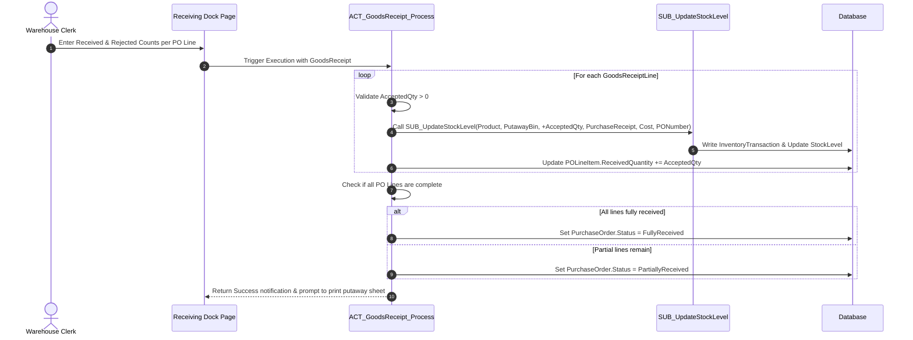
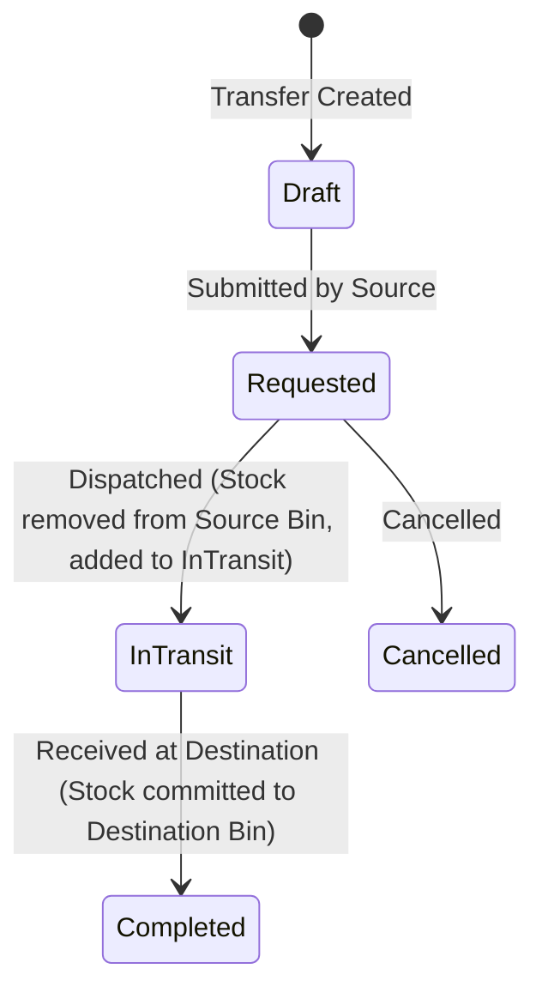

# Mendix Business Logic & Microflows Specification

This document details the core microflow architectures, execution flows, and transaction integrity mechanisms for the Inventory Management System (IMS).

---

## 1. The Core Transaction Engine: `SUB_UpdateStockLevel`

Every operation that increases or decreases stock (receiving, picking, scrap, transfer, count reconciliation) MUST route through `SUB_UpdateStockLevel`. Direct modification of `StockLevel.QuantityOnHand` elsewhere in the application is strictly prohibited.

### Flowchart



### Microflow Parameters
- `Product` (Object: `MasterData.Product`)
- `LocationBin` (Object: `MasterData.LocationBin`)
- `DeltaQuantity` (Decimal: Positive or Negative)
- `TransactionType` (Enum: `Inventory.TransactionType`)
- `UnitCost` (Decimal: Cost per unit at transaction time)
- `ReferenceNumber` (String: PO, SO, or Audit Reference)
- `Notes` (String)

### Database Concurrency & Locking
To avoid race conditions when multiple warehouse clerks pick from the same bin simultaneously:
- Use an XPath retrieve on `StockLevel` with database row-level locking or optimistic retry handling:
  ```xpath
  [StockLevel_Product = $Product and StockLevel_LocationBin = $LocationBin]
  ```
- If the resulting `QuantityOnHand` would drop below zero, roll back the transaction and return an error message to the UI.

---

## 2. Inbound Goods Receiving: `ACT_GoodsReceipt_Process`

Executed when a warehouse receiver completes the physical check of incoming goods against an active Purchase Order.



---

## 3. Outbound Order Reservation & Dispatch

### A. Stock Reservation: `SUB_ReserveStockForOrder`
When a sales order is accepted:
1. Iterate through each `SalesOrderLine`.
2. Retrieve available stock across bins for `Product`:
   ```xpath
   [StockLevel_Product = $Product and QuantityOnHand > QuantityReserved]
   ```
3. Allocate reservations using FIFO (bins sorted by closest picking route).
4. Increment `StockLevel.QuantityReserved += AllocatedQty`.
5. Update `SalesOrderLine.ReservedQuantity += AllocatedQty`.
6. If total reserved < ordered, flag line as `Backordered`.

### B. Shipping Dispatch: `ACT_SalesOrder_Dispatch`
Executed when the carrier picks up the packed parcel:
1. For each `SalesOrderLine`:
   - Call `SUB_UpdateStockLevel(Product, PickBin, -PickedQuantity, SalesFulfillment, UnitCost, SONumber)`.
   - Decrement `StockLevel.QuantityReserved -= PickedQuantity`.
2. Update `SalesOrder.Status = Shipped`.
3. Set `SalesOrder.CarrierTrackingCode` and dispatch confirmation email to customer.

---

## 4. Stock Transfer Between Warehouses: `ACT_StockTransfer_Dispatch` & `ACT_StockTransfer_Receive`

Two-phase commit for multi-site transfers:



1. **On Dispatch (`ACT_StockTransfer_Dispatch`)**:
   - Call `SUB_UpdateStockLevel(Product, SourceBin, -ShippedQty, TransferOut, Cost, TransferNo)`.
   - Increment `StockLevel.QuantityInTransit += ShippedQty` on the source warehouse.
   - Update `StockTransfer.Status = InTransit`.
2. **On Receipt (`ACT_StockTransfer_Receive`)**:
   - Call `SUB_UpdateStockLevel(Product, DestinationBin, +ReceivedQty, TransferIn, Cost, TransferNo)`.
   - Decrement source warehouse `StockLevel.QuantityInTransit -= ReceivedQty`.
   - Update `StockTransfer.Status = Completed`.

---

## 5. Automated Reorder Evaluation: `SE_EvaluateReorderThresholds`

Configured as a **Mendix Scheduled Event** running nightly at `03:00 UTC`.

### Algorithm
```mendix
// Pseudo-code in Mendix Microflow
List<Product> ActiveProducts = Retrieve [IsActive = true()];

For each Product in ActiveProducts {
    Decimal TotalOnHand = Sum(Product/StockLevel.QuantityOnHand);
    Decimal TotalReserved = Sum(Product/StockLevel.QuantityReserved);
    Decimal TotalOnOrder = Sum(Product/POLineItem[PurchaseOrder.Status in ('Approved', 'Issued')].OrderedQuantity - ReceivedQuantity);
    
    Decimal NetStockPosition = (TotalOnHand + TotalOnOrder) - TotalReserved;
    Decimal Threshold = Product/StockLevel.ReorderPoint;
    
    If NetStockPosition <= Threshold {
        // Create Alert Record
        Create InventoryAlert {
            Product: Product,
            CurrentPosition: NetStockPosition,
            ReorderPoint: Threshold,
            SuggestedOrderQty: Product/StockLevel.MaximumStock - NetStockPosition,
            GeneratedDate: CurrentDateTime()
        }
        // Send email to Purchasing Team if Priority is High
    }
}
```
