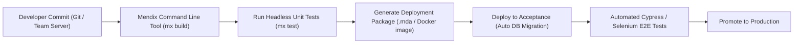

# Mendix Deployment & Best Practices

This document outlines architectural best practices, database indexing strategies, performance optimizations, testing protocols, and CI/CD pipelines for deploying the Inventory Management System (IMS).

---

## 1. Database Indexing & Performance Guidelines

In an enterprise warehouse with tens of thousands of SKUs and millions of inventory transaction records, improper indexing will degrade performance.

### Required Database Indexes

In Mendix Studio Pro domain models, explicitly create the following indexes:

| Entity | Index Type | Attributes / Associations | Purpose |
| :--- | :--- | :--- | :--- |
| `MasterData.Product` | Unique | `SKU` | Instant lookup on barcodes and external references |
| `MasterData.Product` | Unique | `Barcode` | Real-time scanner response (<50ms) |
| `Inventory.StockLevel` | Composite Unique | `StockLevel_Product`, `StockLevel_LocationBin` | Fast retrieval of exact bin stock balance |
| `Inventory.InventoryTransaction` | Single | `Timestamp` | Efficient time-series ledger retrieval and valuation reporting |
| `Inventory.InventoryTransaction` | Single | `ReferenceNumber` | Rapid audit trace by PO, SO, or Audit count ID |
| `Procurement.PurchaseOrder` | Unique | `PONumber` | Order status tracking |
| `Fulfillment.SalesOrder` | Unique | `SONumber` | Fulfillment status lookups |

### Mendix Performance Rules
1. **Never Calculate Stock on the Fly via Aggregates**:
   - Do NOT calculate current stock by summing all `InventoryTransaction` rows during every UI page load.
   - Maintain the pre-calculated projection in `StockLevel.QuantityOnHand` updated atomically by `SUB_UpdateStockLevel`.
2. **Limit XPath Retrievals**:
   - Always paginate Data Grid 2 lists (e.g. 20-50 records per page).
   - Use indexed attribute filters in XPath constraints rather than filtering lists in microflow memory loops.
3. **Batch Commit in Loops**:
   - When importing 10,000 products or closing a 500-item cycle count, accumulate objects into a list and commit every 250 items. Commit outside the loop.
4. **Use Asynchronous Task Queues**:
   - Heavy operations (e.g. daily reorder point recalculation, PDF bulk generation, webhook dispatches) MUST execute via **Mendix Task Queue** to keep the interactive web session snappy.

---

## 2. Automated Testing with Mendix UnitTesting Module

Install the **UnitTesting** module from the Mendix Marketplace to maintain code quality:

### Core Unit Test Microflows
1. **`UT_SUB_UpdateStockLevel_PositiveReceipt`**:
   - Creates dummy Product & Bin.
   - Calls `SUB_UpdateStockLevel` with +50.
   - Asserts `StockLevel.QuantityOnHand == 50`.
   - Asserts 1 `InventoryTransaction` created with `TransactionType = PurchaseReceipt`.
2. **`UT_SUB_UpdateStockLevel_PreventNegativeStock`**:
   - Calls `SUB_UpdateStockLevel` with -10 when on-hand is 0.
   - Asserts microflow throws custom error and rolls back database state.
3. **`UT_ReserveStockForOrder_FIFOAllocation`**:
   - Sets up multiple bins with varying stock.
   - Calls reservation engine.
   - Verifies reservation allocated across bins in correct sequence without exceeding total available.

---

## 3. Deployment Environments & CI/CD Pipelines

### Deployment Targets
- **Mendix Cloud Dedicated / Mendix Cloud v4**: Recommended for standard cloud deployments with automatic PostgreSQL scaling and SSL certificate provisioning.
- **On-Premise / Private Cloud (Docker / Kubernetes)**: For air-gapped warehouses or enterprise hybrid topologies using the **Mendix Docker Buildpack**.

### CI/CD Pipeline Steps

1. **Version Control**: Manage branch lines per sprint (e.g. `sprint/2026-S01`) synchronized with git worktrees and Scrumit task branches.
2. **Database Migrations**:
   - Mendix automatically computes DDL changes between revisions.
   - For high-volume production tables (`InventoryTransaction`), review generated SQL scripts before promoting to production to verify no table lock contention.
