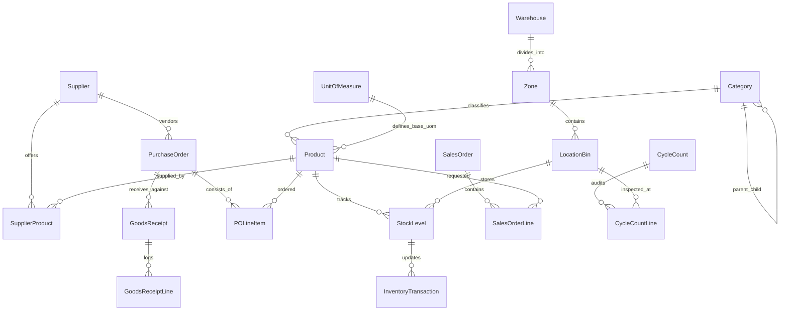

# Mendix Domain Model Specification

This document details the complete entity-relationship model for the Inventory Management System (IMS) built in Mendix Studio Pro.

---

## 1. Entity-Relationship Overview

---

## 2. MasterData Module Entities

### `Product`
Represents an inventory item or SKU.
- **Attributes**:
  - `SKU` (String, 64, Unique, Mandatory, Indexed)
  - `Name` (String, 200, Mandatory)
  - `Description` (String, Unlimited)
  - `Barcode` (String, 128, Unique, Indexed) — UPC, EAN, or Code128
  - `CostPrice` (Decimal, 18, 4, Mandatory, Default: 0.0000)
  - `SellingPrice` (Decimal, 18, 4, Mandatory, Default: 0.0000)
  - `WeightKg` (Decimal, 10, 3)
  - `DimensionsCm` (String, 50) — Length x Width x Height
  - `IsActive` (Boolean, Default: True)
  - `CreatedAt` (DateTime)
  - `UpdatedAt` (DateTime)
- **Associations**:
  - `Product_Category` (Many-to-One -> `Category`)
  - `Product_BaseUnitOfMeasure` (Many-to-One -> `UnitOfMeasure`)
  - `Product_DefaultImage` (One-to-One -> `System.Image`)

### `Category`
Hierarchical product categorization.
- **Attributes**:
  - `Code` (String, 32, Unique, Mandatory)
  - `Name` (String, 100, Mandatory)
  - `Description` (String, 255)
- **Associations**:
  - `Category_ParentCategory` (Many-to-One -> `Category`) — Self-referential tree

### `UnitOfMeasure`
Defines handling and packaging quantities.
- **Attributes**:
  - `Code` (String, 10, Unique, Mandatory) — e.g. `PCS`, `BOX12`, `PALLET`, `KG`
  - `Name` (String, 50, Mandatory)
  - `ConversionFactor` (Decimal, 10, 4, Default: 1.0) — Multiple of base unit

### `Warehouse`
Physical facility storing inventory.
- **Attributes**:
  - `Code` (String, 20, Unique, Mandatory)
  - `Name` (String, 100, Mandatory)
  - `AddressLine1` (String, 150)
  - `City` (String, 100)
  - `StateProvince` (String, 50)
  - `PostalCode` (String, 20)
  - `Country` (String, 50)
  - `IsActive` (Boolean, Default: True)

### `Zone`
Specific functional area inside a warehouse.
- **Attributes**:
  - `Code` (String, 20, Mandatory)
  - `Name` (String, 100)
  - `ZoneType` (Enumeration: `ReceivingStaging`, `BulkStorage`, `ActivePicking`, `PackingAndShipping`, `QuarantineDamaged`, `ColdStorage`)
- **Associations**:
  - `Zone_Warehouse` (Many-to-One -> `Warehouse`)

### `LocationBin`
The smallest discrete storage address.
- **Attributes**:
  - `BinCode` (String, 50, Mandatory, Indexed) — e.g., `WH1-A03-S02-B14`
  - `Aisle` (String, 10)
  - `Rack` (String, 10)
  - `Shelf` (String, 10)
  - `BinPosition` (String, 10)
  - `MaxWeightKg` (Decimal, 10, 2)
  - `MaxVolumeM3` (Decimal, 10, 3)
  - `IsLocked` (Boolean, Default: False) — Locked during cycle counts or maintenance
- **Associations**:
  - `LocationBin_Zone` (Many-to-One -> `Zone`)
  - **Validation / Constraint**: Composite unique key `(Zone_Warehouse, BinCode)`

### `Supplier`
Vendor profile for procurement.
- **Attributes**:
  - `SupplierCode` (String, 32, Unique, Mandatory)
  - `CompanyName` (String, 150, Mandatory)
  - `ContactName` (String, 100)
  - `Email` (String, 150)
  - `Phone` (String, 50)
  - `PaymentTerms` (Enumeration: `Net15`, `Net30`, `Net60`, `Prepaid`, `DueOnReceipt`)
  - `LeadTimeDays` (Integer, Default: 7)
  - `RatingScore` (Decimal, 3, 2, Default: 5.0)

---

## 3. Inventory Module Entities

### `StockLevel`
Maintains the current stock projection for a specific product at a specific bin.
- **Attributes**:
  - `QuantityOnHand` (Decimal, 12, 2, Default: 0) — Total physical units present
  - `QuantityReserved` (Decimal, 12, 2, Default: 0) — Allocated to open sales orders
  - `QuantityAvailable` (Calculated attribute or Microflow-maintained: `OnHand - Reserved`)
  - `QuantityInTransit` (Decimal, 12, 2, Default: 0) — En route in inter-warehouse transfer
  - `ReorderPoint` (Decimal, 12, 2, Default: 10) — Minimum threshold triggering replenishment
  - `SafetyStock` (Decimal, 12, 2, Default: 5)
  - `MaximumStock` (Decimal, 12, 2, Default: 100)
  - `LastCountDate` (DateTime)
- **Associations**:
  - `StockLevel_Product` (Many-to-One -> `Product`)
  - `StockLevel_LocationBin` (Many-to-One -> `LocationBin`)
- **Indexes**: Composite unique index on `(StockLevel_Product, StockLevel_LocationBin)`.

### `InventoryTransaction`
The immutable financial & operational audit record for any stock movement.
- **Attributes**:
  - `TransactionNumber` (AutoNumber)
  - `TransactionType` (Enumeration: `PurchaseReceipt`, `SalesFulfillment`, `TransferOut`, `TransferIn`, `AdjustmentPlus`, `AdjustmentMinus`, `CycleCountVariance`)
  - `QuantityDelta` (Decimal, 12, 2, Mandatory) — Positive for additions, negative for reductions
  - `BalanceAfter` (Decimal, 12, 2, Mandatory)
  - `UnitCost` (Decimal, 18, 4)
  - `TotalCost` (Decimal, 18, 4)
  - `ReferenceNumber` (String, 100) — PO Number, SO Number, Transfer ID, or Audit ID
  - `ReasonNotes` (String, 255)
  - `Timestamp` (DateTime, Default: CurrentDateTime, Indexed)
- **Associations**:
  - `InventoryTransaction_Product` (Many-to-One -> `Product`)
  - `InventoryTransaction_LocationBin` (Many-to-One -> `LocationBin`)
  - `InventoryTransaction_StockLevel` (Many-to-One -> `StockLevel`)
  - `InventoryTransaction_User` (Many-to-One -> `Administration.Account`)

### `StockTransfer` & `StockTransferLine`
Manages inter-warehouse or bin-to-bin movements.
- **Attributes (`StockTransfer`)**:
  - `TransferNumber` (String, 32, Unique)
  - `Status` (Enumeration: `Draft`, `Requested`, `InTransit`, `Completed`, `Cancelled`)
  - `ShipmentDate` (DateTime)
  - `ArrivalDate` (DateTime)
  - `TrackingNumber` (String, 100)
- **Associations (`StockTransfer`)**:
  - `StockTransfer_SourceWarehouse` (Many-to-One -> `Warehouse`)
  - `StockTransfer_DestinationWarehouse` (Many-to-One -> `Warehouse`)
- **Attributes (`StockTransferLine`)**:
  - `RequestedQty` (Decimal, 12, 2)
  - `ShippedQty` (Decimal, 12, 2)
  - `ReceivedQty` (Decimal, 12, 2)
- **Associations (`StockTransferLine`)**:
  - `StockTransferLine_StockTransfer` (Many-to-One -> `StockTransfer`)
  - `StockTransferLine_Product` (Many-to-One -> `Product`)
  - `StockTransferLine_SourceBin` (Many-to-One -> `LocationBin`)
  - `StockTransferLine_DestinationBin` (Many-to-One -> `LocationBin`)

---

## 4. Procurement Module Entities

### `PurchaseOrder` & `POLineItem`
- **Attributes (`PurchaseOrder`)**:
  - `PONumber` (String, 32, Unique, Indexed)
  - `Status` (Enumeration: `Draft`, `PendingApproval`, `Approved`, `Issued`, `PartiallyReceived`, `FullyReceived`, `Closed`, `Cancelled`)
  - `OrderDate` (DateTime)
  - `ExpectedDeliveryDate` (DateTime)
  - `SubtotalAmount` (Decimal, 18, 2)
  - `TaxAmount` (Decimal, 18, 2)
  - `TotalAmount` (Decimal, 18, 2)
  - `ApprovalComments` (String, 500)
- **Associations**:
  - `PurchaseOrder_Supplier` (Many-to-One -> `Supplier`)
  - `PurchaseOrder_DestinationWarehouse` (Many-to-One -> `Warehouse`)
  - `PurchaseOrder_CreatedBy` (Many-to-One -> `Administration.Account`)
- **Attributes (`POLineItem`)**:
  - `LineNumber` (Integer)
  - `OrderedQuantity` (Decimal, 12, 2)
  - `ReceivedQuantity` (Decimal, 12, 2, Default: 0)
  - `UnitPrice` (Decimal, 18, 4)
  - `LineTotal` (Decimal, 18, 2)

---

## 5. Fulfillment Module Entities

### `SalesOrder` & `SalesOrderLine`
- **Attributes (`SalesOrder`)**:
  - `SONumber` (String, 32, Unique, Indexed)
  - `CustomerName` (String, 150)
  - `ShippingAddress` (String, 255)
  - `Status` (Enumeration: `Created`, `StockReserved`, `Picking`, `Packed`, `Shipped`, `Delivered`, `Cancelled`)
  - `OrderDate` (DateTime)
  - `Carrier` (String, 50)
  - `CarrierTrackingCode` (String, 100)
- **Attributes (`SalesOrderLine`)**:
  - `LineNumber` (Integer)
  - `OrderedQuantity` (Decimal, 12, 2)
  - `ReservedQuantity` (Decimal, 12, 2, Default: 0)
  - `PickedQuantity` (Decimal, 12, 2, Default: 0)
  - `ShippedQuantity` (Decimal, 12, 2, Default: 0)
  - `UnitPrice` (Decimal, 18, 4)

---

## 6. InventoryAudit Module Entities

### `CycleCount` & `CycleCountLine`
- **Attributes (`CycleCount`)**:
  - `CountNumber` (String, 32, Unique)
  - `CountType` (Enumeration: `ScheduledBlind`, `SpotCheck`, `ABC_VelocityBased`)
  - `Status` (Enumeration: `Planned`, `InProgress`, `PendingApproval`, `Reconciled`, `Cancelled`)
  - `ScheduledDate` (DateTime)
  - `TotalVarianceValue` (Decimal, 18, 2)
- **Attributes (`CycleCountLine`)**:
  - `SystemSnapshotQuantity` (Decimal, 12, 2) — Captured at count start; hidden from counting clerk!
  - `CountedQuantity` (Decimal, 12, 2) — Filled during blind audit
  - `VarianceQuantity` (Calculated: `CountedQuantity - SystemSnapshotQuantity`)
  - `VarianceValue` (Calculated: `VarianceQuantity * UnitCost`)
  - `IsReconciled` (Boolean, Default: False)
- **Associations**:
  - `CycleCountLine_CycleCount` (Many-to-One -> `CycleCount`)
  - `CycleCountLine_Product` (Many-to-One -> `Product`)
  - `CycleCountLine_LocationBin` (Many-to-One -> `LocationBin`)
