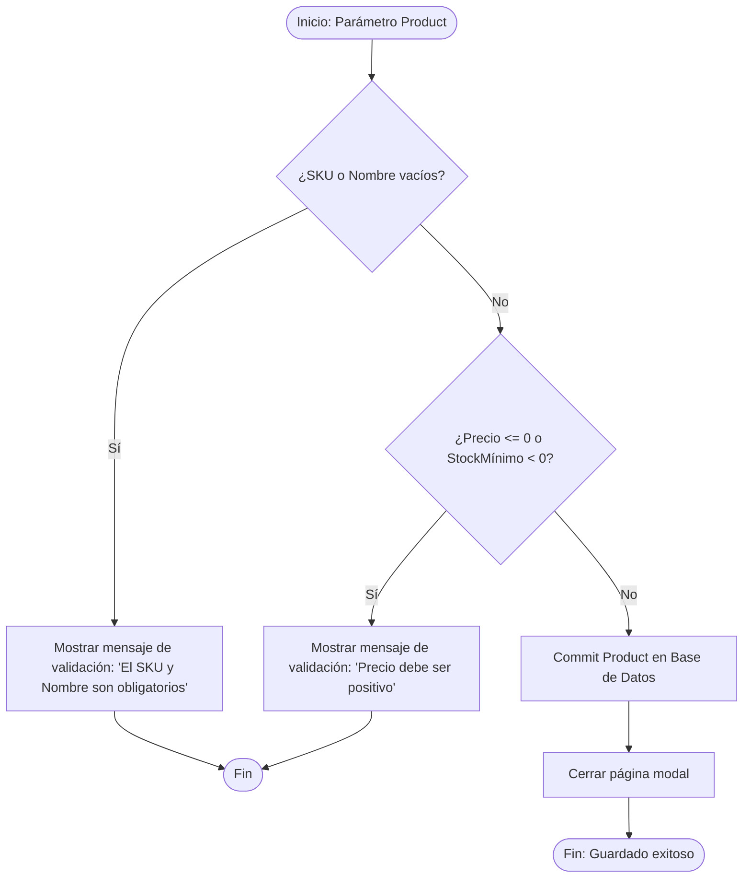
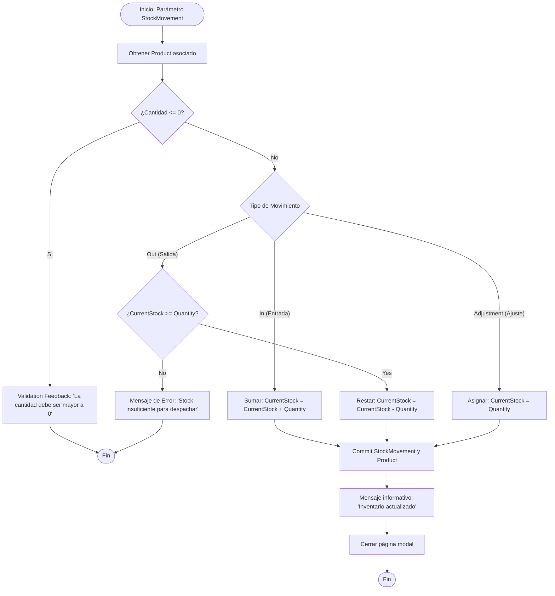

# Lógica de Negocio y Microflows

En Mendix, los **Microflows** son diagramas de flujo visuales que ejecutan la lógica del servidor. Para este demo solo requerimos **dos microflows esenciales**:

1. **`ACT_Product_Save`**: Validación previa antes de guardar un producto.
2. **`ACT_StockMovement_Process`**: Cálculo de existencias (+/-) al registrar una entrada o salida.

---

## 1. Microflow: `ACT_Product_Save`

Se ejecuta al hacer clic en el botón **Guardar** del formulario de producto.



### Pasos en Mendix Studio Pro:
1. Crear microflow `ACT_Product_Save` con parámetro de entrada `Product`.
2. Insertar una decisión (`Exclusive Split`):
   ```mendix
   $Product/SKU != empty and trim($Product/SKU) != '' and
   $Product/Name != empty and trim($Product/Name) != ''
   ```
3. Si es falso: Insertar actividad **Validation Feedback** en el miembro `SKU` o `Name`.
4. Insertar segunda decisión para verificar `Price > 0`.
5. Si pasa las validaciones: Actividad **Commit** (`Product`) y actividad **Close Page**.

---

## 2. Microflow: `ACT_StockMovement_Process`

Se ejecuta al confirmar el registro de un movimiento de inventario en la ventana emergente.



### Pasos en Mendix Studio Pro:
1. Crear microflow `ACT_StockMovement_Process` con parámetro de entrada `StockMovement`.
2. Actividad **Retrieve** por asociación para traer el objeto `Product`:
   ```mendix
   $StockMovement/InventoryManagement.StockMovement_Product
   ```
3. Actividad de Decisión para evaluar `MovementType`:
   - **Caso `In` (Entrada):**
     - Actividad **Change Object** (`Product`):
       - Atributo `CurrentStock`: `$Product/CurrentStock + $StockMovement/Quantity`
   - **Caso `Out` (Salida):**
     - Decisión: `$Product/CurrentStock >= $StockMovement/Quantity`
     - Si es verdadero: Actividad **Change Object** (`Product`):
       - Atributo `CurrentStock`: `$Product/CurrentStock - $StockMovement/Quantity`
     - Si es falso: Actividad **Show Message** (Error: "No hay existencias suficientes para realizar la salida").
   - **Caso `Adjustment` (Ajuste):**
     - Actividad **Change Object** (`Product`):
       - Atributo `CurrentStock`: `$StockMovement/Quantity`
4. Actividad **Commit** guardando tanto `StockMovement` como `Product`.
5. Actividad **Close Page**.

---

## 3. Regla Visual de Stock Bajo

Para mostrar una alerta visual directa en el Catálogo de Productos y en el Dashboard:
- En las columnas o tarjetas del Data Grid 2, utiliza **Dynamic Classes** o **Conditional Visibility**:
  ```mendix
  $currentObject/CurrentStock <= $currentObject/MinimumStock
  ```
- Si se cumple la condición, aplica la clase CSS de Atlas UI `text-danger font-weight-bold` o muestra un badge rojo con la leyenda `"¡Stock Crítico!"`.
