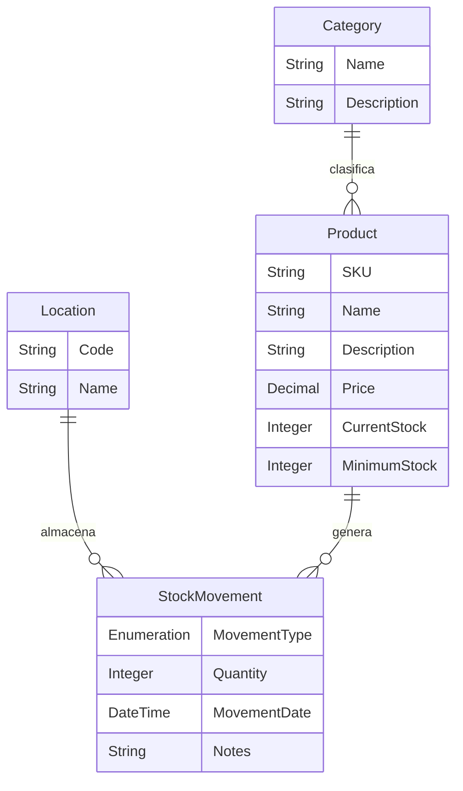

# Modelo de Datos Simplificado (Domain Model)

Para esta práctica de demo en Mendix, el modelo de datos se ha simplificado a **4 entidades esenciales** y **1 enumeración**, facilitando el aprendizaje y la rapidez de implementación.

---

## 1. Diagrama Entidad-Relación (ER)

---

## 2. Detalle de Entidades y Atributos

### 1. `Product` (Producto)
Almacena el catálogo de artículos y el balance de existencias.
- **`SKU`** (*String, longitud 30*): Código único de identificación del producto (ej: `PROD-001`).
- **`Name`** (*String, longitud 100*): Nombre del producto (ej: `Teclado Mecánico RGB`).
- **`Description`** (*String, unlimited*): Descripción detallada del artículo.
- **`Price`** (*Decimal, 10, 2*): Precio unitario de venta.
- **`CurrentStock`** (*Integer, default 0*): Cantidad física actual disponible en almacén.
- **`MinimumStock`** (*Integer, default 5*): Nivel umbral que dispara la alerta de stock bajo.
- **Herencia o Imagen**: Asociado a `System.Image` si deseas mostrar fotos de los productos.

### 2. `Category` (Categoría)
Organiza los productos por familias o grupos.
- **`Name`** (*String, longitud 50*): Nombre de la categoría (ej: `Electrónica`, `Herramientas`, `Oficina`).
- **`Description`** (*String, longitud 200*): Breve descripción.

### 3. `Location` (Ubicación / Almacén)
Identifica el lugar físico dentro de la empresa.
- **`Code`** (*String, longitud 20*): Código de ubicación (ej: `ALM-CENTRAL`, `PASILLO-A`).
- **`Name`** (*String, longitud 100*): Nombre descriptivo (ej: `Almacén Principal`).

### 4. `StockMovement` (Movimiento de Inventario)
Registra el historial de cada entrada y salida de mercancía.
- **`MovementType`** (*Enumeration: `MovementType`*): Tipo de operación.
  - `In` (Entrada por compra o recepción)
  - `Out` (Salida por venta o despacho)
  - `Adjustment` (Ajuste manual de conteo)
- **`Quantity`** (*Integer*): Cantidad de unidades involucradas en el movimiento.
- **`MovementDate`** (*DateTime, default: `CurrentDateTime`*): Fecha y hora del registro.
- **`Notes`** (*String, longitud 200*): Motivo u observaciones (ej: `Factura F-102`, `Merma por rotura`).

---

## 3. Asociaciones en Mendix Studio Pro

| Asociación | Multiplicidad | Descripción |
| :--- | :--- | :--- |
| `Product_Category` | Muchos a Uno (`* -> 1`) | Una categoría agrupa muchos productos; un producto pertenece a una sola categoría. |
| `StockMovement_Product` | Muchos a Uno (`* -> 1`) | Un movimiento corresponde a un producto específico. |
| `StockMovement_Location` | Muchos a Uno (`* -> 1`) | Un movimiento se realiza en una ubicación o almacén específico. |
