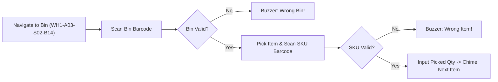

# Mendix UI & UX Design Specification

This document details the user interface architecture, screen designs, Atlas UI components, and mobile device experiences for the Inventory Management System (IMS).

---

## 1. Design System & Theme Settings

- **Framework**: Mendix **Atlas UI 3.0** with **Data Grid 2**.
- **Color Palette**:
  - Primary Brand: Navy `#1B365D` (stability, corporate oversight)
  - Secondary Accent: Teal `#00A3AD` (actionable triggers, primary buttons)
  - Success / In-Stock: Forest Green `#2E7D32`
  - Warning / Low Stock: Amber `#ED6C02`
  - Danger / Out of Stock / Discrepancy: Crimson `#D32F2F`
- **Navigation Profiles**:
  - **Responsive Web**: Optimized for 1920x1080 and 1366x768 desktop monitors (Warehouse Office & Manager Workstations).
  - **Tablet / Mobile Web (PWA)**: Optimized for handheld warehouse touchscreens and ruggedized scanning terminals (Zebra TC52, Honeywell CT40).

---

## 2. Key Pages and Workflows

### A. Operations & Executive Dashboard (`Dashboard_Overview.page.xml`)
The command center for Inventory Managers:
1. **KPI Header Cards**:
   - Total Active SKUs
   - Total Inventory Valuation ($ USD)
   - Items Below Reorder Point (Red badge with count)
   - Pending Goods Receipts (PO Receiving Dock count)
   - Today's Open Pick Waves
2. **Interactive Visuals**:
   - Stock Turnover & Velocity Chart (Bar Chart widget)
   - Stock Aging Breakdown (<30 days, 31-90 days, >90 days)
3. **Actionable Alerts Feed**:
   - Real-time list of low-stock items with direct "Create Draft PO" button.

### B. Product Catalog & Stock Inspector (`Product_Overview.page.xml`)
Built with **Data Grid 2**:
- **Columns**: Thumbnail, SKU, Name, Category, Base UoM, Total On-Hand, Total Reserved, Total Available, Unit Cost, Selling Price, Status.
- **Search & Filter Controls**:
  - Debounced text search on SKU, Name, and Barcode.
  - Dropdown multi-select for Category and Warehouse filter.
  - Custom range slider for Available Stock.
- **Row Actions**:
  - Click row -> Opens `Product_Detail.page.xml` in pop-up modal or master-detail split panel.
  - Context menu: "View Transaction History", "Initiate Stock Adjustment", "Print Barcode Label".

### C. Dock-Side Goods Receiving Screen (`PO_Receiving_Workstation.page.xml`)
Engineered for rapid, error-free physical intake:
1. **Header**: PO Selector (or scan PO barcode) -> Displays Supplier, Expected Date, Carrier.
2. **Split Comparison Grid**:
   | Line # | SKU | Product Name | Ordered | Previously Rcvd | Receiving Now (Input) | Rejected (Input) | Putaway Target Bin | Discrepancy |
   | :--- | :--- | :--- | :--- | :--- | :--- | :--- | :--- | :--- |
   | 01 | SKU-104 | Industrial Valve | 100 | 0 | `[ 100 ]` | `[ 0 ]` | `WH1-A01-B04` |  Green (Match) |
   | 02 | SKU-209 | Pressure Gauge | 50 | 0 | `[ 45 ]` | `[ 5 ]` | `QUARANTINE-01`|  Red (Damaged) |
3. **Quick Actions**:
   - "Receive All Remaining" button.
   - "Attach Packing Slip Photo" (drag-and-drop or camera widget).
   - "Finalize Receipt & Print Putaway Sheet" (primary button).

### D. Mobile Picking & Scanning Interface (`Mobile_PickWave.page.xml`)
Optimized for single-hand warehouse floor operation:
- **Large High-Contrast Font**: Displays current target bin in 36pt font (e.g., `Aisle 3 -> Shelf 2 -> Bin 14`).
- **Optimal Route Ordering**: Lines pre-sorted by warehouse coordinate layout to eliminate backtrack walking.
- **Scan-to-Confirm**: Clerk cannot confirm pick without scanning the physical bin barcode and item SKU barcode.
- **Audio Feedback**: Pleasant chime on valid match; distinct buzzer on mismatch.

---

## 3. Barcode & QR Code Integration

- **Widget**: Mendix Marketplace **Barcode Scanner** widget (HTML5 Camera API / Cordova plugin).
- **Symbologies Supported**:
  - Code 128 (standard warehouse logistics labels)
  - EAN-13 / UPC-A (retail consumer packaging)
  - QR Code (compact representation of SKU + Lot + Serial number)
- **Nanoflow Action (`NANO_OnBarcodeScanned`)**:
  - Takes raw barcode string from widget callback.
  - Calls microflow or client-side cache to retrieve matching `Product` or `LocationBin`.
  - Automatically advances focus to quantity input or confirms the pick line.
